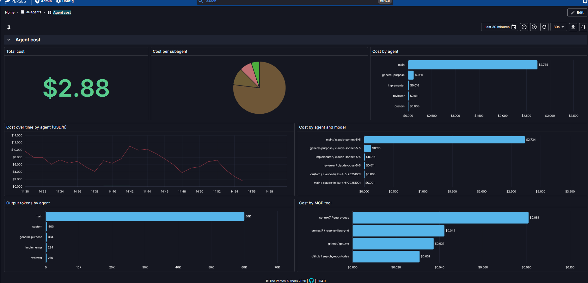

# claude-cost-otel

See what your Claude Code agents cost, locally. One command starts an OpenTelemetry
stack, loads an **Agent cost** dashboard into Perses and turns on Claude Code's
telemetry export.



The dashboard answers: how much did each agent (`main`, `reviewer`, `implementer`,
`general-purpose`, ...) cost, on which model, and which MCP tools drive spend.

## Quick start

Requirements: Docker with Compose, Python 3 (tested on 3.13, Windows 11). No Python packages needed.

```bash
python claude_cost_otel.py setup
```

This:

1. runs `docker compose up -d` and waits for Perses and Prometheus,
2. loads the **Agent cost** dashboard into Perses (project `ai-agents`),
3. merges the telemetry variables below into `~/.claude/settings.json`
   (a timestamped backup is kept, unrelated settings are left alone).

Then restart Claude Code, send a prompt, and open <http://localhost:8080> →
**ai-agents** → **Agent cost**. Data shows up within about a minute; spawn a subagent
to see the per-agent panels fill in.

Preview without changing anything: `python claude_cost_otel.py setup --dry-run`.

## What gets enabled in Claude Code

These go into the `env` block of your **user** settings (`~/.claude/settings.json`).
`CLAUDE_CODE_ENABLE_TELEMETRY` is ignored in project and local settings, so the tool
only writes user-level settings.

| Variable | Value | Why |
|---|---|---|
| `CLAUDE_CODE_ENABLE_TELEMETRY` | `1` | Master switch for OpenTelemetry export. |
| `OTEL_METRICS_EXPORTER` | `otlp` | Cost and token counters, which feed the dashboard. |
| `OTEL_LOGS_EXPORTER` | `otlp` | Per-request events (`api_request`, `tool_result`, ...), stored in Loki. |
| `OTEL_TRACES_EXPORTER` | `otlp` | Spans per interaction, model request and tool call, viewable in Jaeger. |
| `CLAUDE_CODE_ENHANCED_TELEMETRY_BETA` | `1` | Required for traces (beta). Metrics and logs work without it. |
| `OTEL_EXPORTER_OTLP_PROTOCOL` | `grpc` | Claude Code has no default protocol; the collector listens on gRPC. |
| `OTEL_EXPORTER_OTLP_ENDPOINT` | `http://localhost:4317` | The local collector. |
| `OTEL_METRIC_EXPORT_INTERVAL` | `10000` | Export every 10 s instead of the default 60 s, so the dashboard reacts quickly. |
| **`OTEL_LOG_TOOL_DETAILS`** | `1` | **The detail flag.** Puts real agent, skill, plugin and MCP server/tool names on the cost and token counters. |

Without `OTEL_LOG_TOOL_DETAILS`, Claude Code does not report real agent and MCP names
on those counters, so the per-agent and per-MCP-tool panels lose their meaning. See the
[Claude Code monitoring docs](https://code.claude.com/docs/en/monitoring-usage).

### Privacy

`OTEL_LOG_TOOL_DETAILS=1` also adds tool parameters to log events and trace spans:
Bash commands, file paths, URLs, search patterns and MCP tool names. In this setup
that data stays on your machine (Loki and Jaeger, bound to `127.0.0.1`), but it
is more than the default. Pass `--no-tool-details` to `setup` or `enable` to leave
the flag off.

## The tool

```
python claude_cost_otel.py setup      # stack + dashboards + Claude Code settings
python claude_cost_otel.py enable     # only the Claude Code settings
python claude_cost_otel.py disable    # remove the variables this tool manages
python claude_cost_otel.py dashboard  # (re)load dashboards into a running Perses
python claude_cost_otel.py status     # settings, service health, dashboard present?
python claude_cost_otel.py down       # stop the stack (--purge also deletes volumes)
```

Useful options: `--dry-run`, `--settings PATH`, `--endpoint URL`, `--interval MS`,
`--no-tool-details`, `--perses-url URL`, and for `setup` `--skip-stack`,
`--skip-dashboard`, `--skip-claude`.

`enable` is idempotent and `disable` removes only the variables listed above.

## What runs

| Service | URL | Purpose |
|---|---|---|
| OpenTelemetry Collector | `localhost:4317` (OTLP gRPC) | Receives everything, routes each signal. |
| Prometheus | <http://localhost:9090> | Metrics. Started with `--web.enable-otlp-receiver` and `--enable-feature=otlp-deltatocumulative` so it accepts OTLP directly. |
| Perses | <http://localhost:8080> | Dashboards, no login in this local setup. |
| Jaeger | <http://localhost:16686> | Traces, browsable in its own UI. The dashboards do not use them; the span-based **Tools** panels come from `spanmetrics` in the collector. |
| Loki | <http://localhost:3100> | Log events, received through Loki's native OTLP endpoint. Perses can chart them with LogQL. |

All ports are bound to `127.0.0.1`.

### The dashboard

Defined in [`perses/provisioning/dashboards/agent-cost.json`](perses/provisioning/dashboards/agent-cost.json).
Perses provisions the dashboards on start, and `claude_cost_otel.py dashboard` pushes
them into a running Perses. The **Agent cost** dashboard has these panels:

- **Total cost**
- **Cost per subagent** (pie, main session excluded)
- **Cost by agent** (`main` is the session itself)
- **Cost over time by agent** (USD/h)
- **Cost by agent and model**
- **Output tokens by agent**
- **Cost by MCP tool**

A separate **Tools** dashboard
([`tools.json`](perses/provisioning/dashboards/tools.json)) shows what the agents'
tools do rather than what they cost:

- **Tool calls** per tool
- **Average tool duration** per tool
- **Time blocked on user** (waiting for permission decisions)
- **Tool errors**
- **Tool result size by tool** (bytes returned into the context, from Loki log events)

Individual prompts and their spans (LLM requests, tool calls, subagents, permission
waits) are not on a dashboard; browse them in Jaeger at <http://localhost:16686>.

### Limits worth knowing

- **No cost per built-in tool.** Claude Code attributes cost to agents, models and MCP
  tools, not to Bash, Read, Edit and the like. The **Tools** dashboard shows calls, duration
  and result size instead, and result size is the best proxy for what a tool adds to
  the context, and so to later cache-read cost.
- **The log panel uses a fixed 5-minute window.** Perses documents its built-in range
  variables only for Prometheus queries, so the Loki panel does not use them.
- **Loki is slow to report ready.** Its `/ready` answers 503 for the first minutes after
  start. `status` shows that as `wait`, and logs are accepted in the meantime.
- **Short-lived agents can be slightly undercounted.** The first sample of a new
  metric series has no baseline, so `increase()` skips it. The panels fall back to
  `last_over_time` for series with a single sample, but a series with several samples
  can still under-count its first batch.
- **Right after a run, panels may lag.** Metrics are exported on an interval, so a
  subagent that just finished may take up to the export interval to appear.

## Changes from upstream

This repository started from
[dash0-community/claude-code-monitoring](https://github.com/dash0-community/claude-code-monitoring)
(Apache-2.0, see [LICENSE](LICENSE) and [NOTICE](NOTICE)). Differences:

- Published ports are bound to `127.0.0.1` instead of all interfaces.
- The Perses container runs as `0:0` because its data volume is root-owned.
- `otelcol.yaml` adds a `spanmetrics` connector that turns spans into
  `claude_code_span_calls_total` and `claude_code_span_duration_milliseconds_*`,
  labelled by tool, session, user, span type and query source.
- Replaces OpenSearch, Data Prepper and OpenSearch Dashboards with a single Loki
  container. The collector sends logs to Loki's native OTLP endpoint, and Perses has a
  provisioned Loki datasource.
- Replaces the upstream **Claude Code Metrics** dashboard with the **Agent cost**
  dashboard and adds `claude_cost_otel.py`.
- Drops the upstream `data/` directory, which the compose file does not use.

## Troubleshooting

```bash
python claude_cost_otel.py status      # what is up, what is configured
docker compose ps
docker compose logs -f otelcol         # telemetry arriving, export errors
claude --debug                         # OpenTelemetry export errors on the Claude side
```

- **Dashboard is empty:** restart Claude Code after `setup`; the variables are read at
  start. Then send a prompt and wait one export interval.
- **A panel says `main` only:** no subagents have run yet in the selected time range.
- **Port already in use:** another stack (for example the upstream demo) is running;
  `docker compose down` there first.

## Cleanup

```bash
python claude_cost_otel.py disable        # remove the Claude Code variables
python claude_cost_otel.py down --purge   # stop the stack and delete its data
```
